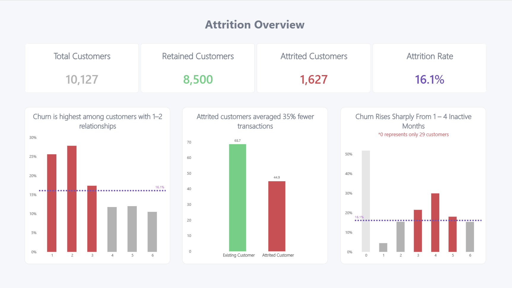
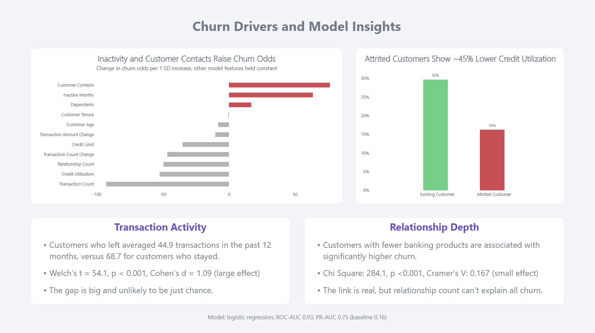
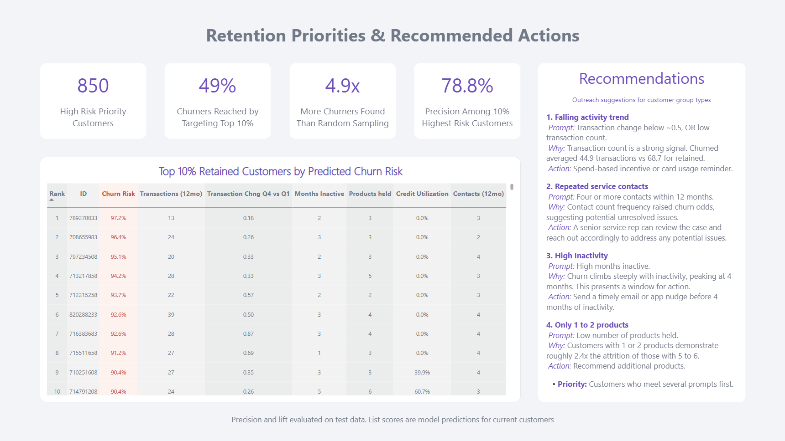

# Credit Card Customer Churn and Retention Analysis

- Business question: Which credit card customers have the highest risk of churn, why, and who should the company prioritize to contact.

- Tools: PostgreSQL, Python (pandas, SciPy, scikit-learn), Power BI

# Key findings

- 16.1% is the baseline churn rate.
- Declining activity is the strongest signal. Customers who left averaged 44.9 transactions a year versus 68.7 for those who stayed (Cohen's d = 1.09).
- Fewer relationships are associated with more attrition. Customers with 1-2 products churned at 26.9% versus 11.3% for those with 5-6.
- Inactivity and repeated service contacts raise churn risk, which goes from 4.5% at 1 inactive month to 29.9% at 4.
- The model is good at ranking customers, with a PR-AUC 0.75 against a 0.16 baseline on held-out data. The top 10% of high risk customers represents 49% of churners. This delivers 4.9x the hit rate of random targeting.

The dashboard creates an illustrative priority list of 850 high risk customers, and provides recommendations on how to reduce attrition for these groups, tailored to risk factors.

# Considerations

- Metrics come from a single train/test split.
- The model shows associations, not causes.
- The recommended actions are untested. A control group test would validate the recommendations.

# How to run

1. Install dependencies
2. Configure .env
3. Run data_preparation.ipynb
4. Create the PostgreSQL database/table
5. Run load_table.py
6. Run exploratory_analysis.sql
7. Run statistical_modelling.ipynb
8. Open the Power BI report

Dataset used: [Credit Card Customers](https://www.kaggle.com/datasets/sakshigoyal7/credit-card-customers) (Kaggle).